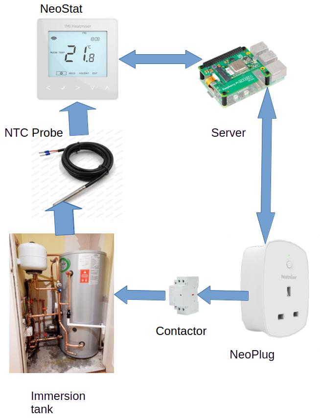

# Heatmiser Neohub Immersion Control

This project is a simple bash script to read the hot water temperature of a Heatmiser controlled heating system, then initiate an immersion heater boost if it falls below a set temperature. 
## The Problem
Heatmiser do not produce a device that monitors and controls electric immersion heater tank systems. A simple timer function is avaialble in the Neostat series, but there is no temperature monitoring. 
With the availability of cheap off-peak electricity ( usually overnight) there is a tendency to heat water during this period only, then rely on limited usage and tank insulation to provide hot water for the rest of the day until the next heating cycle. 
While this mostly works, unexpected loads can quickly diminish the hot water temperature, perhaps before any secondary daytime programmed boost kicks in.
A Neostat can accept an external NTC probe, typically for undefloor heating monitoring, but there is no mechanism to set a suitably high temperature (typically 60 degC  or so) and operate an external double pole 20A contactor, required for UK immersion switching. 

## The Solution
Using a Neostat with external probe to monitor the tank temperature and a NeoPlug to provide the contactor control, this script reads the Neostat temperature, compares it with a preset threshold and, if below, sets the NeoPlug on for a preset time, then switches it off. The NeoPlug is already programmed with timed sequences for off-peak and secondary boost times, so this script just kicks it again if needed. (The NeoPlug also acts as a Zigbee Mesh relay to improve connectivity)
## The Script
This is a simple bash script, running on a local e.g. raspberry pi server using cron as the hourly scheduler. To prevent overriding an Away setting, the Away status is checked first and the script aborted if set.
Also, communication uses the legacy (port 4242) address, simplifying the script considerably since it is always run locally. 
For clarity, there is no command optimisation here, mostly because it could obscure the way the code works for first time users. The Neohub API can be a bit obscure too, so bits of this can be used to just build your own app, although for anything more complex, I suggest using the Python Neohub API (https://github.com/rikkuness/neohubapi) which also includes the secure port comms over port 4243.
 
## Usage
Supply arguments to set ip address of the neohub, the low threshold temperature to initiate a boost, the boost time (in seconds), the name of the NeoPlug,(which should be the same as in your controlling app), and the numerical ID of the monitoring Neostat. Make sure everything has been paired successfully. 
(Find the id of your neostat from the Zones displayed in the terminal. Set this as an argument.)
N.B. UK Regulations require Immersion Heaters to be run from a dedicated supply with a double pole switch to isolate. Do not use the NeosPlug for this, just to fire a DP Contactor. Use a qualified electrician to install. 
N.B. 2. The immersion heater temperature is still controlled by its own embedded thermostat and overheat cutout. 

